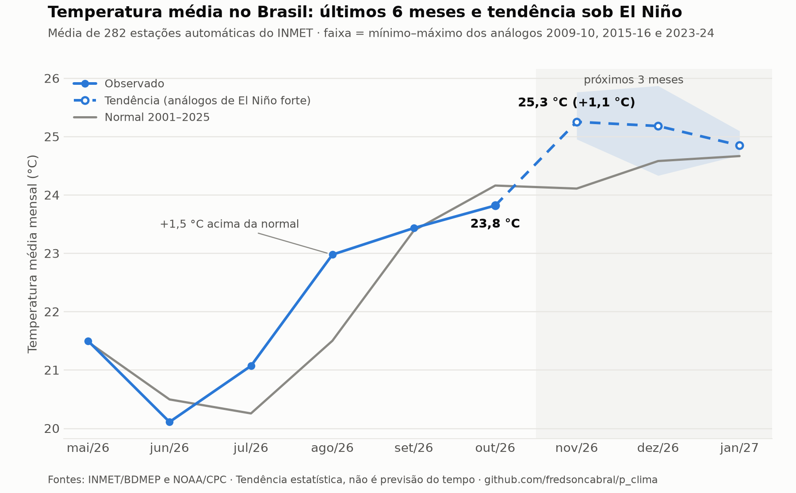
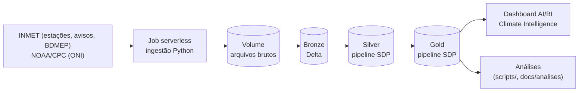
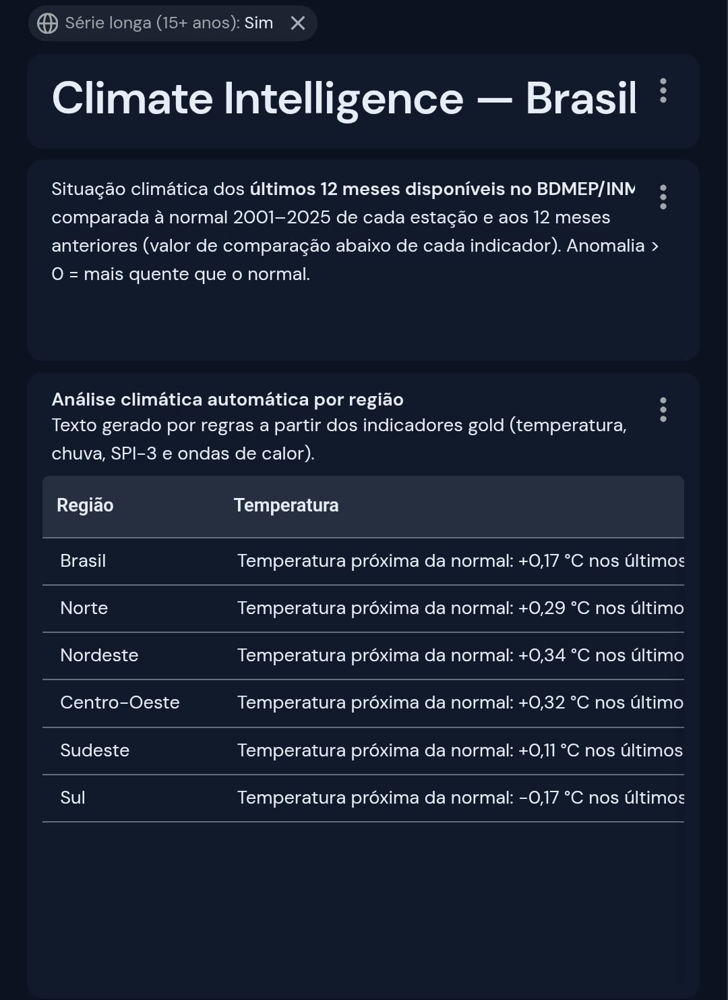
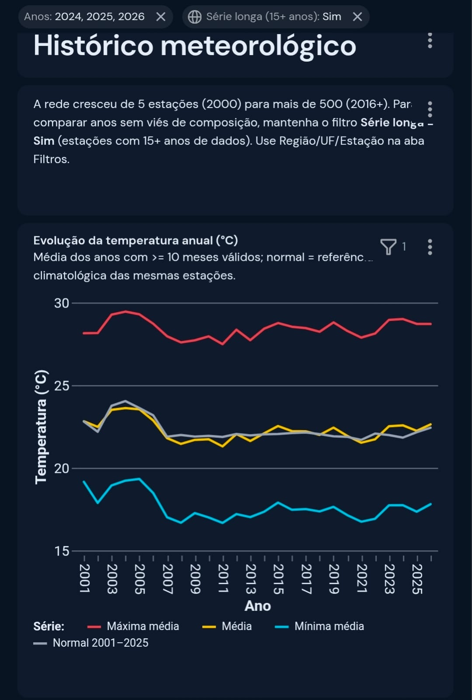
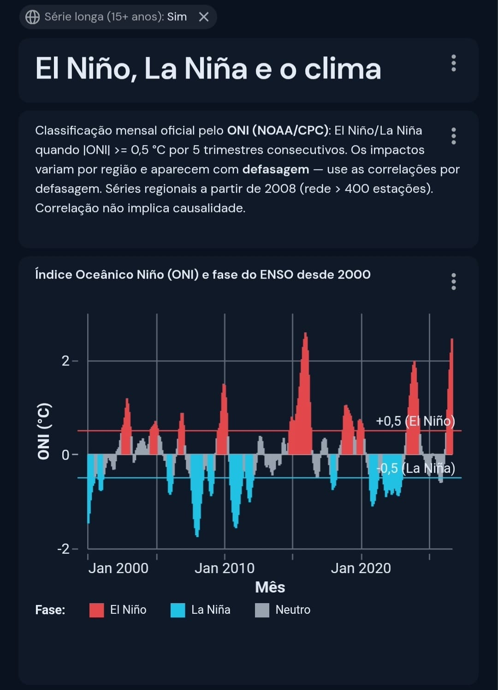
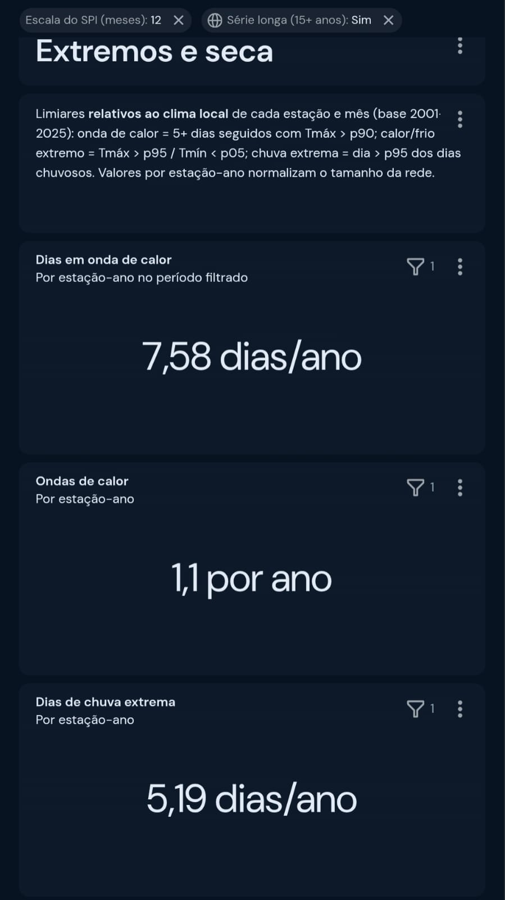
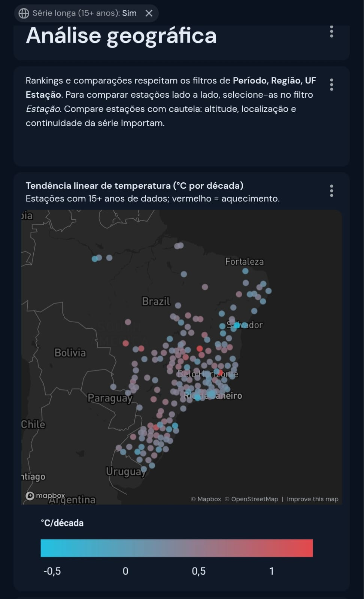

# Climate Intelligence Brasil — dados do INMET no Databricks

[](https://github.com/fredsoncabral/p_clima/actions/workflows/ci.yml)
[](LICENSE)

Plataforma de **engenharia e análise de dados climáticos** construída sobre o histórico das estações
automáticas do **INMET** (2000–2026) e o índice **ENSO da NOAA**. O projeto vai da ingestão das APIs
públicas até um dashboard analítico, passando por uma arquitetura medalhão, controle de qualidade de
sensores e índices climáticos calculados no Lakehouse.



## Perguntas que o projeto responde

- Como está o clima agora em cada região, comparado à normal e ao ano anterior?
- Este ano está mais quente ou mais chuvoso que os anteriores?
- Como El Niño e La Niña afetam temperatura e chuva em cada região — e com que defasagem?
- Onde há seca (SPI), excesso de chuva, ondas de calor ou ar muito seco?
- Como temperaturas e chuvas mudaram nas últimas duas décadas (tendência por estação)?

## Destaques

| | |
|---|---|
| **Volume** | 89,6 milhões de registros horários, 704 estações, 2000 a 2026, ~2,5 GB de arquivos compactados |
| **Arquitetura** | Bronze → Silver → Gold no Unity Catalog, tudo como código (Declarative Automation Bundles) |
| **Orquestração** | Job serverless diário + 2 pipelines Lakeflow Declarative (SQL e Python) |
| **Ingestão incremental** | BDMEP só é recarregado quando o arquivo do ano muda na origem (controle por tamanho/`Last-Modified`) |
| **Qualidade de dados** | Expectations nos pipelines + regras de QC que detectaram sensores com defeito (ex.: 45 °C em Salvador no inverno, pluviômetros travados por meses) |
| **Índices climáticos** | Anomalias vs. normal, ondas de calor com limiares locais, SPI 1/3/6/12 meses, índice de calor (NOAA), tendência linear, classificação ENSO |
| **Consumo** | Dashboard AI/BI "Climate Intelligence" com 5 páginas, gerado e validado por script |
| **Engenharia de software** | Pacote Python (wheel), testes, lint e CI no GitHub Actions |

## Arquitetura



Detalhes e decisões de projeto em [docs/arquitetura.md](docs/arquitetura.md).

## Stack

Databricks (Unity Catalog, Delta Lake, Lakeflow Jobs, Lakeflow Spark Declarative Pipelines, AI/BI Dashboards,
SQL Warehouse serverless) · Python 3.12 · PySpark · pandas · SciPy · SQL · uv · ruff · pytest · GitHub Actions.

## Camadas de dados

| Camada | Principais tabelas | O que acontece |
|---|---|---|
| **Bronze** | `bronze_inmet_bdmep_horario`, `bronze_inmet_estacoes`, `bronze_inmet_avisos`, `bronze_noaa_oni` | Dado como veio da fonte (strings) + auditoria (`_arquivo_origem`, `_ingerido_em`) |
| **Silver** | `silver_inmet_bdmep_horario`, `silver_inmet_estacoes`, `silver_inmet_avisos`, `silver_noaa_oni` | Tipagem, `-9999` → nulo, dois layouts de data/hora unificados em UTC, expectations |
| **Gold** | diário, mensal, anual, normais, anomalias, eventos extremos, SPI, tendência, ENSO, resumo regional | Métricas analíticas com regras de validade e QC de sensores |

Catálogo completo: [docs/catalogo_dados.md](docs/catalogo_dados.md) · Regras e índices: [docs/metodologia.md](docs/metodologia.md).

## Dashboard "Climate Intelligence"

| Página | Conteúdo |
|---|---|
| 01 · Visão geral | Resumo automático por região, fase atual do ENSO, KPIs de 12 meses vs. 12 anteriores, mapa de anomalias, avisos vigentes |
| 02 · Histórico | Temperatura anual (média/máx./mín./normal), chuva anual vs. normal, sazonalidade entre anos, matriz ano × mês, boxplot |
| 03 · El Niño / La Niña | Série do ONI por fase, impactos por região, correlações com defasagem, episódios desde 2000 |
| 04 · Extremos e seca | Ondas de calor por década e UF, frequência de dias acima do p95, mapa e série do SPI |
| 05 · Geográfica | Tendência °C/década por estação, rankings, indicadores por UF, comparação entre estações |

### Galeria

<table>
  <tr>
    <td align="center"><br><sub>01 · Visão geral — resumo automático por região</sub></td>
    <td align="center"><br><sub>02 · Histórico — temperatura anual vs. normal</sub></td>
  </tr>
  <tr>
    <td align="center"><br><sub>03 · El Niño / La Niña — ONI e fases desde 2000</sub></td>
    <td align="center"><br><sub>04 · Extremos e seca — ondas de calor</sub></td>
  </tr>
  <tr>
    <td align="center"><br><sub>05 · Geográfica — tendência °C/década por estação</sub></td>
    <td></td>
  </tr>
</table>

O JSON do dashboard (`src/dashboards/clima_inmet.lvdash.json`) é **gerado** por
[`scripts/gerar_dashboard.py`](scripts/gerar_dashboard.py), que valida os vínculos entre campos e widgets e a
sobreposição do layout; o CI garante que o JSON versionado está sincronizado com o script.

## Análises

- [Impactos esperados do El Niño 2026-27 no Brasil](docs/analises/el_nino_2026_2027.md) — análise com os dados do
  projeto (análogos 2009-10, 2015-16 e 2023-24) e os boletins oficiais de INMET/INPE e NOAA.
- Gráfico acima: [`scripts/grafico_linkedin.py`](scripts/grafico_linkedin.py) — dados em
  [docs/analises/dados_grafico_linkedin.csv](docs/analises/dados_grafico_linkedin.csv).

## Estrutura do repositório

```text
├── databricks.yml                  # bundle: targets dev/prod, variáveis
├── resources/                      # job, pipelines e dashboard (YAML)
├── src/
│   ├── p_clima/inmet/              # ingestão: cliente HTTP, parser do BDMEP, tarefas (wheel)
│   ├── pipelines/inmet_silver/     # materialized views da silver (SQL)
│   ├── pipelines/inmet_gold/       # gold (SQL + SPI em Python)
│   └── dashboards/                 # JSON do dashboard AI/BI (gerado)
├── scripts/                        # gerador do dashboard e gráficos de análise
├── tests/                          # testes unitários (rodam offline)
└── docs/                           # arquitetura, catálogo, metodologia, análises
```

## Como executar

Pré-requisitos: [Databricks CLI](https://docs.databricks.com/dev-tools/cli/install) ≥ 0.250, [uv](https://docs.astral.sh/uv/)
e um workspace Databricks com Unity Catalog e serverless.

```bash
# 1. dependências locais
uv sync --dev

# 2. autenticação (o workspace não fica fixo no repositório — veja .env.example)
databricks auth login --host https://<seu-workspace>.cloud.databricks.com --profile meu-perfil

# 3. deploy (dev) e carga completa: estações, avisos, ENSO, BDMEP 2000→hoje, silver e gold
databricks bundle deploy -t dev --profile meu-perfil
databricks bundle run inmet_ingestao -t dev --profile meu-perfil

# qualidade local
uv run ruff check src scripts tests
uv run pytest -q tests
```

O catálogo/schema padrão é `workspace.clima` (dev) e `workspace.clima_prod` (prod), configurável em `databricks.yml`.
Em produção (`-t prod`) o job roda diariamente às 06:00 (horário de Brasília).

## Limitações conhecidas

- A normal usa 2001–2025 (a rede automática começa em 2000); a normal oficial da OMM tem 30 anos.
- A rede cresceu de 5 para 500+ estações: comparações nacionais entre anos usam o filtro de **série longa** (15+ anos).
- Médias nacionais e por UF são médias simples entre estações, sem ponderação por área.
- As regras de QC são heurísticas; alguns defeitos ainda passam (ex.: −9,5 °C em Ipanguaçu-RN, em uma estação sem
  histórico suficiente para limiares locais).
- Correlações ENSO × clima são exploratórias (2008+, sem remoção de autocorrelação).
- A API de observações em tempo real do INMET exige token; a tarefa existe, mas fica inativa sem ele.

## Próximos passos

- Previsão de 7–30 dias (INMET/CPTEC) com histórico de previsões para avaliar erro (MAE, RMSE, viés).
- SPEI (evapotranspiração) e índices adicionais (MJO, IOD, AAO).
- Recorte por município (IBGE) e modelos de ML para detecção de anomalias e clusterização climática.

## Fontes de dados

- **INMET** — Instituto Nacional de Meteorologia: [BDMEP / dados históricos](https://portal.inmet.gov.br/dadoshistoricos),
  API de estações e avisos.
- **NOAA Climate Prediction Center** — [Oceanic Niño Index (ONI)](https://www.cpc.ncep.noaa.gov/data/indices/oni.ascii.txt).

Os dados pertencem às respectivas instituições; este repositório contém apenas código e documentação.

## Licença

Código e documentação sob a [licença MIT](LICENSE). A licença não se aplica aos dados do INMET e da NOAA,
que seguem os termos de uso de cada instituição.

---

Desenvolvido por [@fredsoncabral](https://github.com/fredsoncabral) como projeto de portfólio em engenharia e análise de dados.
