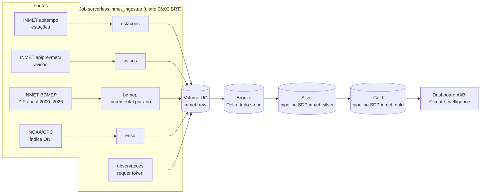

# Arquitetura

Lakehouse em camadas (medalhão) no Databricks, todo definido como código em um
**Declarative Automation Bundle** (`databricks.yml` + `resources/`), com computação serverless.



## Orquestração

O job `inmet_ingestao` (`resources/inmet_ingestao.job.yml`) roda tarefas Python empacotadas
em um wheel (`src/p_clima`, entry point `inmet`) e depois dispara os dois pipelines declarativos:

```text
estacoes ─┐
avisos ───┤
enso ─────┼──► silver (pipeline inmet_silver) ──► gold (pipeline inmet_gold)
bdmep ────┘
estacoes ──► observacoes (só executa se houver token no secret scope `inmet`)
```

| Decisão | Motivo |
|---|---|
| Arquivo bruto sempre salvo no volume antes da tabela bronze | Rastreabilidade e reprocessamento sem depender da fonte |
| Bronze só com strings + colunas de auditoria (`_arquivo_origem`, `_ingerido_em`) | A fonte muda layout (ex.: formato de data/hora do BDMEP entre anos); tipagem fica na silver |
| BDMEP incremental por ano com tabela de controle (`_controle_bdmep`) | Só baixa de novo o ZIP cujo tamanho/`Last-Modified` mudou (~2,5 GB no histórico completo) |
| `replaceWhere` por `ano` na bronze do BDMEP | Recarga idempotente de um ano sem tocar os demais |
| Materialized views (SQL) em pipelines Lakeflow SDP | Lineage, expectations de qualidade e refresh incremental (row tracking na bronze) |
| SPI em Python (`applyInPandas` + `scipy`) dentro do pipeline | Ajuste de distribuição gama não existe em SQL |
| Dashboard gerado por script (`scripts/gerar_dashboard.py`) | O JSON do AI/BI é verboso; o gerador valida bindings de campos e layout antes do deploy |
| Workspace parametrizado (perfil da CLI / `DATABRICKS_HOST`) | Nenhuma URL ou usuário fixo no repositório |

## Ambientes

| Target | Schema | Observação |
|---|---|---|
| `dev` (padrão) | `workspace.clima` | `mode: development` — recursos prefixados e agendamentos pausados |
| `prod` | `workspace.clima_prod` | Agendamento diário ativo; caminho fixo no usuário que faz o deploy |

## Conectividade

O INMET recusa conexões de algumas redes (inclusive a máquina local usada no desenvolvimento);
a partir do serverless do Databricks todas as fontes respondem. Por isso os testes de integração
HTTP são feitos com jobs efêmeros no workspace, não localmente.
